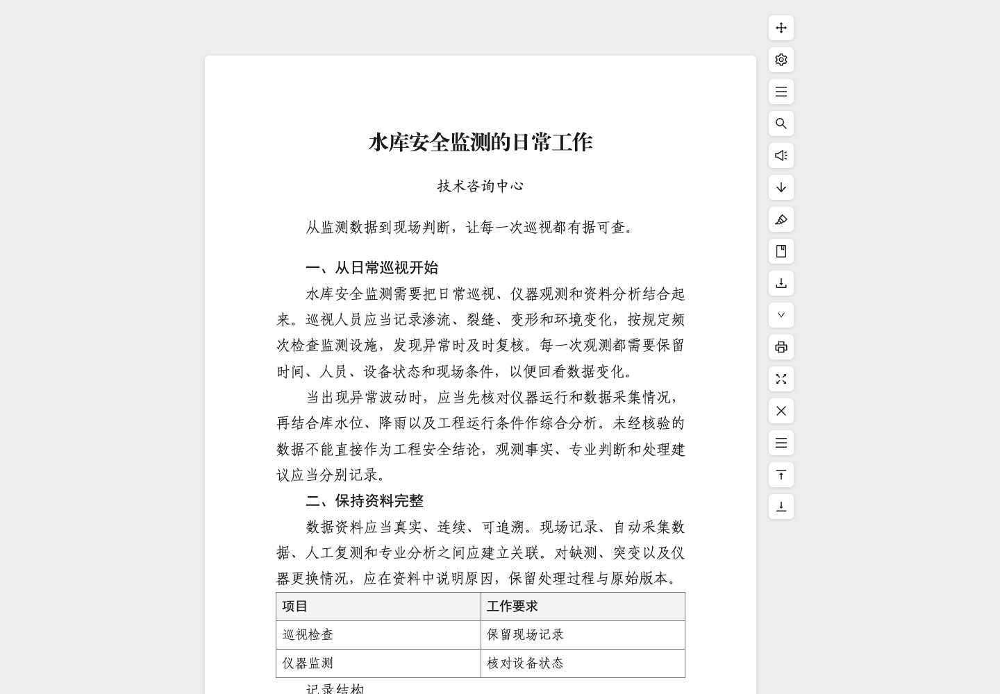

# iReadFolio · i悦读

A browser extension for focused web reading, typography, annotations, and document archiving.

[简体中文](README.md) · [Privacy](docs/PRIVACY.md) · [Provenance](docs/PROVENANCE.md) · [Contributing](CONTRIBUTING.md)



## Features

- Extract article content, select content manually, apply site rules, navigate an outline, and append same-origin next pages.
- Customize body text, title, six heading levels, signatures, tables, and page numbers; save named styles and a default style.
- Choose installed fonts in Chrome, recognize Chinese numbered headings, and use the Chinese official-document preset.
- Highlight and annotate text; organize saved articles with categories, tags, archives, and local JSON backups.
- Export TXT, Markdown, HTML, DOC, DOCX, EPUB, PNG, JPEG, or print/PDF.
- Configure toolbar visibility, ordering, position, active states, and the default export format.
- Make manual, versioned backups to your own WebDAV directory and merge restored data locally.

The interface is currently primarily Simplified Chinese. Extraction quality varies by site. Use manual selection or site rules when automatic extraction is inaccurate.

## Install

Download a browser-specific attachment from [Releases](https://github.com/cikorsky/ireadfolio/releases) and extract it. GitHub's automatic “Source code” archives contain source files and must be built first.

**Chrome / Edge:** enable Developer mode on the extensions page, select **Load unpacked**, and select the extracted Chrome directory. For a source build, load `dist/chrome`.

**Firefox:** open `about:debugging#/runtime/this-firefox`, choose **Load Temporary Add-on**, and select `manifest.json` in the Firefox directory. The supplied XPI is **unsigned**. It is not a signed store release for permanent installation in regular Firefox; temporary installations must be loaded again after a browser restart. A source build produces `dist/firefox`.

This release does not imply availability in the Chrome Web Store or Firefox Add-ons store.

## Use

Click the extension button or the reading entry on an article page. Adjust typography under appearance settings. Detailed controls are initially collapsed. The default shortcut is a double `a`; press `s`, then `t` for settings. Chrome also offers `Alt+R`. Shortcuts are configurable.

Under toolbar settings, select the default export format, image embedding behavior, and filename template. The main export button downloads the default format; the arrow menu temporarily selects another format. Supported filename fields are `[title]`, its alias `[node:title]`, and `[date]`, the UTC export date in `YYYY-MM-DD` format. File extensions are added automatically.

Browser-internal pages, store pages, and protected pages cannot run the extension content script. Local files require the browser's separate file-URL access setting.

## Exports and limitations

| Format | Images and limitations |
| --- | --- |
| Markdown | Embeds images as Base64 in a single `.md` by default; disabling image embedding keeps remote URLs. Some Markdown readers do not support Base64 images. Table conversion currently keeps cell text only, so images inside tables are lost. |
| HTML and DOC | Embeds image data when enabled; otherwise retains remote image URLs. DOC is Word-compatible HTML, not a legacy binary DOC file. |
| DOCX and EPUB | Always package supported images, regardless of the image embedding switch. DOCX uses native Word styles and converts WebP/SVG images to PNG. |
| PNG and JPEG | Render reading content to an image; very large or long pages have size limits. |
| PDF / print | Uses the browser print dialog. The switch changes image loading before printing; disabling it does not remove successfully loaded images from the final PDF. Disable browser-added headers and footers to avoid duplicate page numbering. |
| TXT | Text only. |

Videos are not downloaded or embedded. Embedded iframe players are removed during content cleanup, and video posters are not automatically extracted. Ordinary video links already present in article text may survive. Image downloads can fail because of authentication, hotlink protection, redirects, or codec limitations; failures are reported instead of silently claiming a complete export.

The official-document preset stores font family names, not proprietary font files. The receiving device needs the chosen fonts. Word, WPS, and other layout engines may paginate differently; arbitrary CSS, web widgets, and complex formulas do not necessarily become equivalent native Word objects.

WebDAV provides manual backups rather than real-time synchronization. Configure an existing writable directory, save it, and test the connection. Backups use separate versioned files, and restoration merges records into local data. Export a local backup before important changes. Backup JSON is not end-to-end encrypted; HTTPS protects transport, but the WebDAV server can read its contents.

## Permissions and privacy

Settings, saved articles, annotations, and WebDAV credentials are held in browser-local storage. Credentials are excluded from full JSON backups and are not returned to the password input after reload. The source contains no configured developer article-upload or analytics service. Original page resources, next-page requests, system speech services, and user-enabled WebDAV may still contact the network.

- `<all_urls>` allows the reading entry and extraction on different sites and retrieval of export resources. Browser restrictions still apply.
- `storage` and `unlimitedStorage` support local settings, articles, annotations, and backup configuration.
- `contextMenus` provides reading and manual-selection commands in the browser context menu.
- Chrome's `fontSettings` lists installed fonts; the extension does not change browser-wide font settings. Firefox uses generic font choices when that API is unavailable.

See [Privacy](docs/PRIVACY.md) for storage, network behavior, and deletion details.

## Development

Use Node.js 22 and npm. Install the locked dependencies before running checks:

```sh
npm ci
npm run dev
npm run check
```

`check` runs TypeScript, ESLint, tests, and Chrome/Firefox builds. The development server previews a sample article; extension-only permissions and WebDAV background actions require an installed extension.

Browser tests use isolated temporary profiles and local HTTP/WebDAV fixtures, not personal browser profiles:

```sh
npx playwright install chromium
npm run e2e
node scripts/toolbar-e2e.mjs
```

On Linux, use `npx playwright install --with-deps chromium` when needed. `CHROMIUM_PATH` can select a compatible Chromium executable. Passing fixture tests is not proof of compatibility with every website, Office version, or device.

Build directories are `dist/chrome` and `dist/firefox`; release archives are written to `releases/`. Read [Contributing](CONTRIBUTING.md) before opening a pull request and [Security](SECURITY.md) before reporting a vulnerability.

## License

First-party code is licensed under [Apache-2.0](LICENSE). Third-party dependencies and assets retain their own licenses; see [NOTICE](NOTICE), [third-party notices](public/THIRD_PARTY_LICENSES.txt), and [Provenance](docs/PROVENANCE.md). This license does not grant redistribution rights to websites, imported documents, or system fonts.
