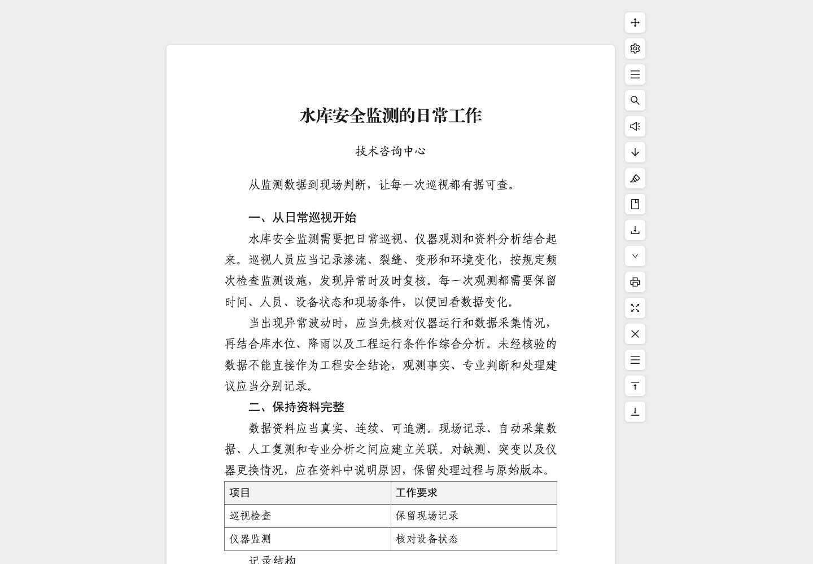

# iReadFolio · i悦读

网页阅读、排版与文档归档扩展。提取正文、调整标题与公文样式、添加批注，并导出可编辑文档或离线阅读文件。

[English](README.en.md) · [隐私说明](docs/PRIVACY.md) · [来源与授权](docs/PROVENANCE.md) · [参与贡献](CONTRIBUTING.md)



## 功能

- 正文提取、手动选择正文、站点规则、目录、查找、多页追加。
- 正文、主标题、六级标题、署名、表格和页码样式；支持另存样式和默认样式。
- Chrome 系统字体下拉选择；“江河公文”预设；中文序号标题识别。
- 高亮、批注、稍后阅读、分类、标签、归档和本地完整备份。
- TXT、Markdown、HTML、DOC、DOCX、EPUB、PNG、JPEG、打印/PDF 导出。
- 工具栏按钮显隐、排序、拖动、启用状态及侧边提示；可直接导出默认格式。
- 用户主动触发的 WebDAV 备份、版本列表和合并恢复。没有开发者托管的文章同步服务。

界面目前以简体中文为主。解析和标题识别存在站点差异，识别不准时可手动选择正文或配置站点规则。

## 安装

从 [Releases](https://github.com/cikorsky/ireadfolio/releases) 下载对应浏览器的发布附件并解压。GitHub 自动生成的 “Source code” 压缩包是源码，需要先构建。

**Chrome / Edge：**打开扩展管理页，开启开发者模式，选择“加载已解压的扩展程序”，指向解压后的 Chrome 目录。源码构建则选择 `dist/chrome`。

**Firefox：**打开 `about:debugging#/runtime/this-firefox`，选择“临时载入附加组件”，再选择 Firefox 目录中的 `manifest.json`。发布中的 XPI 未签名，不是可在正式版 Firefox 中常驻安装的商店包；临时扩展在浏览器重启后需要重新载入。源码构建目录为 `dist/firefox`。

当前发布不代表已经上架 Chrome 网上应用店或 Firefox 附加组件商店。

## 开始使用

1. 在普通文章网页点击浏览器扩展按钮，或网页右下角的阅读入口。
2. 打开偏好设置，在“外观”中选样式，或修改字体、标题、表格和页码。其他格式默认折叠在详细设置中。
3. 在“工具栏 → 默认导出格式”设置导出格式、内嵌图片和文件名。点击导出主按钮即可下载，箭头菜单临时选择其他格式。
4. 在“配置管理”导出完整 JSON 备份，或填写自己的 WebDAV 目录并保存后测试连接。

默认双击 `a` 切换阅读，依次按 `s`、`t` 打开设置；Chrome 另有 `Alt+R`。快捷键可以调整。浏览器内部页、商店页及部分受限页面不能运行阅读脚本；本地文件需要在浏览器扩展设置中另行允许文件网址访问。

文件名支持 `[title]`、同义字段 `[node:title]` 和 UTC 导出日期 `[date]`（`YYYY-MM-DD`）。例如 `[title]-[date]`；扩展名自动添加。

双面打印可在“外观 → 页码样式 → 页码详细设置”开启“奇偶页不同”，分别选择奇数页、偶数页的对齐方式。“江河公文”默认奇数页靠右、偶数页靠左，设置随自定义样式保存，应用于 DOCX 和 Chrome 打印/PDF。

修改图片对齐、字体等外观后，点击“外观 → 样式库 → 保存当前配置”，后续打开的文章会继续使用这份配置。此配置随完整备份保存。选择样式并点击“设为默认样式”可切换后续文章使用的配置。

## 导出与已知限制

| 格式 | 图片处理和边界 |
| --- | --- |
| Markdown | 默认将图片作为 Base64 写入单个 `.md`；关闭内嵌后保留原图网址。部分阅读器不支持 Base64 图片；表格转换目前只保留单元格文字，会丢失表格内图片。 |
| 离线 HTML、Word DOC | 内嵌开启时将图片写入文件，关闭时保留外链。DOC 是兼容 Word 的 HTML 文件，不是旧版二进制 DOC。 |
| Word DOCX、EPUB | 始终将支持的图片打包进文件，不受“导出时内嵌图片”开关影响。DOCX 使用原生 Word 样式；WebP、SVG 图片会转为 PNG。 |
| PNG、JPEG | 对阅读内容生成图片，超长或超大页面有尺寸限制。 |
| PDF / 打印 | 使用浏览器打印窗口；开关影响打印前图片加载方式，不代表关闭后从 PDF 删除图片。请关闭浏览器自带页眉和页脚以免与扩展页码叠加。 |
| TXT | 纯文字，不包含图片。 |

视频不会下载或嵌入，播放器 iframe 会在清理正文时移除；网页已有的普通视频链接可能保留。扩展不会自动提取视频封面。图片下载失败会报错，登录限制、防盗链、重定向及浏览器解码能力可能影响导出。

“江河公文”只提供排版预设，不附带方正、仿宋、楷体等系统字体文件。接收设备需自行具备所选字体。Word/WPS 和其他排版引擎可能产生不同分页；任意网页组件、自定义 CSS 及复杂公式不保证完整转换为 Word 原生对象。

WebDAV 是手动备份，不是实时多设备同步。需要已有的可写 WebDAV 目录；扩展在目录下保存独立版本，不自动删除远端文件。恢复采用合并方式，建议重要操作前先导出本地备份。备份不是端到端加密文件；HTTPS 保护传输，WebDAV 服务端可以读取备份内容。

## 权限与隐私

阅读设置、文章、批注和 WebDAV 凭据保存在浏览器本机存储。凭据不会包含在完整 JSON 备份中，也不回填到页面的密码输入框。代码中没有开发者文章上传服务或行为分析配置；原文资源、翻页、语音服务和主动启用的 WebDAV 仍可能联网。

- `<all_urls>`：在不同站点提供阅读入口、提取正文及读取导出资源；浏览器仍会限制内部页面和受保护页面。
- `storage`、`unlimitedStorage`：保存设置、文章库、批注和备份配置。
- `contextMenus`：提供浏览器右键阅读、手动选择和稍后读入口。
- Chrome 的 `fontSettings`：查询可选择的系统字体，不修改浏览器全局字体设置。Firefox 缺少此接口时使用通用字体选择。

细节和数据删除方式见[隐私说明](docs/PRIVACY.md)。

## 开发与验证

需要 Node.js 22 和 npm。保留 `package-lock.json`，从锁定依赖安装：

```sh
npm ci
npm run dev
npm run check
```

`check` 包含类型检查、ESLint、测试和双浏览器构建。`dev` 打开本地示例界面，不代表浏览器扩展权限或 WebDAV 后台已可用。

浏览器集成测试使用独立临时 profile 和本机测试 HTTP/WebDAV 服务，不读取个人浏览器资料：

```sh
npx playwright install chromium
npm run e2e
node scripts/toolbar-e2e.mjs
```

Linux 首次运行可使用 `npx playwright install --with-deps chromium`。可通过 `CHROMIUM_PATH` 指定兼容的 Chromium 可执行文件。测试会生成本地验证文件，不能据此推断所有网站、Office 版本或设备均已适配。

构建输出位于 `dist/chrome`、`dist/firefox`，安装包位于 `releases/`。提交前请阅读 [CONTRIBUTING.md](CONTRIBUTING.md)，安全问题按 [SECURITY.md](SECURITY.md) 私下报告。

## 许可

本项目的第一方代码按 [Apache-2.0](LICENSE) 许可发布。第三方依赖和素材遵守各自许可证，见 [NOTICE](NOTICE)、[第三方声明](public/THIRD_PARTY_LICENSES.txt)及[来源记录](docs/PROVENANCE.md)。网站文章、用户导入文档和系统字体不因本项目开源而获得再分发授权。
